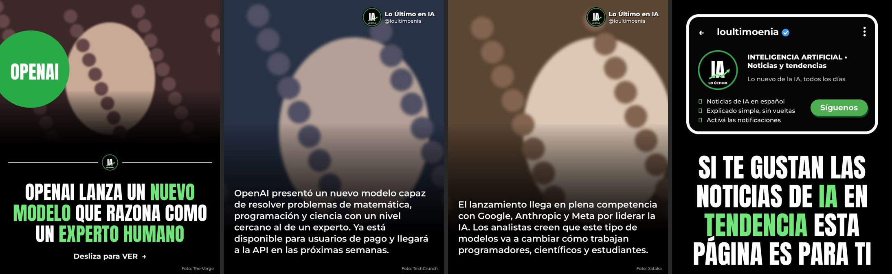

# Lo Último en IA — bot de Instagram

Publica sola carruseles de noticias de IA con diseño propio (azul noche, celeste y violeta):
portada con foto + titular grande, 2 imágenes que explican la noticia y una imagen final
para seguir la cuenta.



## Cómo funciona

1. **Busca tendencias** (`src/news.py`): lee ~10 medios de tecnología (TechCrunch, The Verge,
   Xataka, Wired, Google Noticias…) y agrupa los titulares que hablan de lo mismo (también
   entre inglés y español). La historia que cubren **más medios distintos en las últimas
   horas** es la que está en tendencia; exige al menos 2 (`MIN_SOURCES`). Una nota copiada
   tal cual en varios sitios cuenta como una sola, y los sitios de recomendaciones bursátiles
   están bloqueados (`BLOCKED_SOURCES` en `src/config.py`).
2. **Redacta** (`src/writer.py`): Claude lee las notas y escribe titular, los 2 textos del
   carrusel, el caption y los hashtags en español. Solo usa datos de las notas; si la
   noticia es un rumor, acusa a alguien sin pruebas o es una recomendación de inversión,
   la descarta.
3. **Genera las fotos gratis con IA open source** (`src/imagegen.py`): Claude describe 3
   escenas y **ComfyUI** las genera en esta PC con **FLUX.2 [klein] 4B** (Black Forest Labs,
   licencia Apache 2.0). Nunca muestra personas reales ni logos. Si ComfyUI no está
   disponible, usa la foto principal de la nota con el crédito del medio.
4. **Diseña** (`src/render.py` + `src/templates/carousel.html`): plantilla HTML/CSS
   renderizada con Chromium (Playwright), con tipografías Archivo, Inter y Space Grotesk.
5. **Sube las imágenes a GitHub** (repo público) para que Instagram las pueda descargar.
6. **Publica** (`src/publish.py`): sube el carrusel con la API oficial de Instagram.
7. **Se repite solo**: el Programador de tareas de Windows corre `scripts/run_local.ps1`
   3 veces por día. `state/posted.json` recuerda lo publicado para no repetir.

¿Por qué en la PC y no en GitHub Actions? Los servidores de Actions no tienen placa de video
y ComfyUI tardaría muchísimo ahí. En esta PC (Intel Core Ultra 5, solo procesador) cada
foto tarda ~5 minutos, ~15 minutos por post.

## Puesta en marcha

### 1. ComfyUI (fotos gratis)
En `Documentos\ComfyUI` (fuera de este repo):
```powershell
git clone https://github.com/Comfy-Org/ComfyUI.git
cd ComfyUI
python -m venv .venv
.\.venv\Scripts\python.exe -m pip install torch torchvision torchaudio --index-url https://download.pytorch.org/whl/xpu
.\.venv\Scripts\python.exe -m pip install -r requirements.txt
```
Modelos (todos Apache 2.0):

| Archivo | Carpeta | Origen |
|---|---|---|
| `flux-2-klein-4b-fp8.safetensors` (3,8 GB) | `models/diffusion_models` | huggingface.co/black-forest-labs/FLUX.2-klein-4b-fp8 |
| `qwen_3_4b_fp4_flux2.safetensors` (3,6 GB) | `models/text_encoders` | huggingface.co/Comfy-Org/flux2-klein-4B |
| `flux2-vae.safetensors` (0,3 GB) | `models/vae` | huggingface.co/Comfy-Org/flux2-dev |

No hace falta dejarlo prendido: `run_local.ps1` lo inicia y lo apaga en cada corrida.

### 2. Crear la cuenta de Instagram
- Creá la cuenta **@loultimoenia** (o el usuario que esté libre) desde la app.
- Pasala a **cuenta profesional** (Configuración → Tipo de cuenta → Creador o Empresa).
- Foto de perfil: `docs/logo.png`, o el logo que elijas de Canva.

### 3. Conseguir acceso a la API de Instagram
- Entrá a <https://developers.facebook.com> → Crear app → tipo *Empresa*.
- Agregá el producto **Instagram** → "API con inicio de sesión de Instagram".
- Conectá tu cuenta y generá un **token de acceso** con permisos
  `instagram_business_basic` e `instagram_business_content_publish`.
- Anotá el **ID de usuario de Instagram** que te muestra.
- El token dura 60 días; renovalo antes de que venza.

### 4. Claves (variables de entorno de tu usuario de Windows, nunca en archivos)
En PowerShell, una por una (la clave no se ve ni queda guardada en el historial):
```powershell
$k = Read-Host "Valor" -AsSecureString; [Environment]::SetEnvironmentVariable('NOMBRE', [Net.NetworkCredential]::new('', $k).Password, 'User')
```

| Nombre | Valor |
|---|---|
| `ANTHROPIC_API_KEY` | clave de <https://console.anthropic.com> |
| `IG_USER_ID` | ID de la cuenta de Instagram |
| `IG_ACCESS_TOKEN` | token del paso 3 |
| `IG_GRAPH_HOST` | `graph.instagram.com` |
| `IG_HANDLE` | `@loultimoenia` |
| `AUTO_PUBLISH` | `true` para publicar solo; si no, solo genera y sube las imágenes |

### 5. Subir este proyecto a GitHub
El repo tiene que ser **público** (Instagram descarga las imágenes desde
`raw.githubusercontent.com`). Si preferís privado, poné las imágenes en otro hosting y
definí `PUBLIC_BASE_URL`.

### 6. Probar y programar
```powershell
powershell -ExecutionPolicy Bypass -File scripts\run_local.ps1 -NoPublish   # prueba sin publicar
powershell -ExecutionPolicy Bypass -File scripts\programar_tarea.ps1        # 9:17, 15:17 y 21:17
```
Los registros quedan en `logs/`. La PC tiene que estar prendida (o suspendida: la tarea
la despierta) y con tu sesión iniciada.

Recomendado: empezá con `AUTO_PUBLISH` vacío, revisá unos días los posts que aparecen en
`posts/`, y cuando te convenzan ponelo en `true`.

## Uso manual

```powershell
.\.venv\Scripts\python.exe -m pip install -r requirements.txt
.\.venv\Scripts\python.exe -m playwright install chromium
.\.venv\Scripts\python.exe src\main.py generate   # posts/<fecha>/slide_1..4.jpg + caption
.\.venv\Scripts\python.exe src\main.py publish    # necesita IG_USER_ID, IG_ACCESS_TOKEN, PUBLIC_BASE_URL
```

## Ajustes
- Medios y fuentes bloqueadas: `src/config.py`. Horarios: `scripts/programar_tarea.ps1 -Horas 10:00,18:00`.
- Colores y nombre: `src/config.py`. Diseño: `src/templates/carousel.html` (HTML/CSS común).
- Fotos: estilo en `STYLE` (`src/imagegen.py`); tamaño con `IMAGE_WIDTH`/`IMAGE_HEIGHT`
  (por defecto 768×960); ComfyUI en otra máquina con `COMFYUI_URL`.
- Tipografías en `fonts/` (Archivo, Inter, Space Grotesk; licencia OFL).
- Estilo de redacción: el prompt en `src/writer.py`.

## Ojo con
- **Fotos**: con ComfyUI las imágenes son propias (generadas con IA) y llevan la aclaración
  "Imagen generada con IA". Sin ComfyUI se usa la foto de la nota: tiene derechos de autor y
  un medio puede pedir que la bajes.
- **Límites de Instagram**: máximo 50 publicaciones por día vía API; 3 por día está bien.
- Aunque Claude filtra rumores, conviene revisar de vez en cuando lo que se publica.
